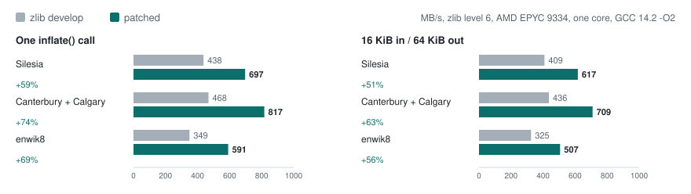

# zlib inflate, about 60% faster, in a 300-line patch

A new fast loop in zlib's `inflate_fast()` and slightly larger decoding tables make `inflate()` 47–74% faster on
standard test corpora, while giving the same output and the same errors as zlib on every input I could produce.

**5 files, +306 / −12 lines, no API change, C89**, on zlib's `develop` branch (1.3.2.1). The patch is
[`patch/0001-Speed-up-inflate_fast-with-a-64-bit-bit-buffer-and-w.patch`](patch/0001-Speed-up-inflate_fast-with-a-64-bit-bit-buffer-and-w.patch)
and is submitted to zlib as [pull request #793](https://github.com/madler/zlib/pull/793).

## Speed

Throughput of `inflate()`, stock zlib against the patched one, on zlib's own streams. One core of an AMD EPYC
9334 (Zen 4, 2.7 GHz), Ubuntu 22.04, GCC 14.2 `-O2`, best of two runs.

<picture>
  <source media="(prefers-color-scheme: dark)" srcset="images/speed-dark.svg">
  
</picture>

| Corpus | Level | One call (MB/s) | 16 KiB in / 64 KiB out (MB/s) |
|---|---|---|---|
| Silesia | 1 | 411 → 646 (+57%) | 384 → 566 (+47%) |
| Silesia | 6 | 438 → 697 (+59%) | 409 → 617 (+51%) |
| Silesia | 9 | 442 → 703 (+59%) | 412 → 620 (+50%) |
| Canterbury + Calgary | 1 | 447 → 724 (+62%) | 419 → 629 (+50%) |
| Canterbury + Calgary | 6 | 468 → 817 (+74%) | 436 → 709 (+63%) |
| Canterbury + Calgary | 9 | 474 → 825 (+74%) | 441 → 718 (+63%) |
| enwik8 | 1 | 343 → 576 (+68%) | 317 → 478 (+51%) |
| enwik8 | 6 | 349 → 591 (+69%) | 325 → 507 (+56%) |
| enwik8 | 9 | 350 → 592 (+69%) | 325 → 506 (+56%) |

`-O3` gives the same gains (+58% to +76% in one call). GCC 11 gives +61% / +54% and clang 18 +55% / +47% on Silesia
level 6. On 32-bit x86, where the 64-bit buffer is emulated, the gain is +9% in one call and +4% in pieces. On
Windows, with Visual Studio 2022 (`cl /O2`) on an Intel Core i7-8850H laptop, level 6 gains +55% to +64% in one call
and +46% to +48% in pieces ([`results/speed_msvc_i7-8850h.txt`](results/speed_msvc_i7-8850h.txt)). For context,
[zlib-ng](https://github.com/zlib-ng/zlib-ng), a performance-focused fork, still decodes about twice as fast as
stock zlib; this patch is for the many programs that use zlib itself. All runs:
[`results/speed_epyc9334.txt`](results/speed_epyc9334.txt).

## What changed

```
 infback.c       |   4 +-
 inffast.c       | 245 ++++++++++++++++++++++++++++++
 inflate.c       |   4 +-
 inftrees.h      |  16 ++--
 test/infcover.c |  49 ++++++
 5 files changed, 306 insertions(+), 12 deletions(-)
```

- **A 64-bit bit buffer, refilled eight bytes at a time.** One load covers a whole length/distance pair (at most
  48 bits) or up to three literals, instead of two byte loads before every code.
- **Matches copied 16 or 8 bytes at a time.** Distances of 16 or more copy in 16-byte chunks and distances of 8
  to 15 in 8-byte chunks. Shorter distances write 8 bytes per step and move on by the distance, so each step
  repeats the pattern; a run of one byte is a repeated 8-byte word. Parts of a match still in the sliding window
  come over with `memcpy`.
- **Larger root tables.** Literal/length codes are looked up with 10 bits instead of 9 and distances with 8 instead
  of 6, so fewer codes need a second lookup. The table sizes come from zlib's own `examples/enough.c`; each stream's
  state grows by 1,152 bytes.
- **Nothing else moves.** The new loop runs while 16 bytes of input and room for a match plus 15 bytes remain;
  zlib's existing loop finishes near the buffer ends exactly as before. Without a 64-bit type (`Z_U8`) the code is
  unchanged.

Where the speed comes from (Silesia, level 6, one call, adding one change at a time; development runs, except the
last row, which is from the table above; in that run the version without the last step measures 652):

| Step | MB/s |
|---|---|
| zlib develop | 437 |
| + 64-bit bit buffer and 8-byte copies | 560 |
| + root tables of 10 and 8 bits | 591 |
| + up to three literals per refill | 644 |
| + 16-byte copies, 8-byte steps for distances below 8 | 697 |

## How it was tested

The standard for a library like zlib is not "faster" but "faster and identical". Every test below compares the
patched zlib with unpatched zlib, not only with the expected output.

| Test | What it checks |
|---|---|
| Damaged streams | 34,860 corrupted streams (bit flips, overwritten bytes, truncations) decoded in random input and output pieces: the same return code, output length and CRC as unpatched zlib for every one. |
| Valid streams | 2,809 checks across 11 compression settings (levels 1/6/9, windows of 512 B to 32 KiB, raw, gzip, Huffman-only, RLE, fixed, stored), decoded in one call, in random pieces each in a buffer of its own exact size, and with `inflateBack()`. |
| Memory checkers | All of the above under AddressSanitizer and UndefinedBehaviorSanitizer, also with the `INFLATE_STRICT`, `INFLATE_ALLOW_INVALID_DISTANCE_TOOFAR_ARRR` and `PKZIP_BUG_WORKAROUND` build options. |
| Six architectures | Identical results on x86-64, 32-bit x86, arm64, ARMv5, ppc64le and big-endian s390x (QEMU), and with MSVC 2022 on Windows. |
| Differential fuzzing | libFuzzer against unpatched zlib, with random input and output piece sizes: 65 million runs under AddressSanitizer and 47 million under UndefinedBehaviorSanitizer, no difference and no report. |
| Streaming | With `Z_SYNC_FLUSH`, every byte before a flush point comes out as soon as its compressed bytes are in (43,815 messages), as interactive protocols need. |
| Coverage | New cases in zlib's `test/infcover.c`, built from hand-made streams, run every line of `inffast.c` on x86 except the byte-wise load for big-endian machines (which runs in the s390x test), and keep `infback.c` and `inftrees.c` at 100% line coverage. |

## Reproduce

Get two zlib trees, stock and patched:

```sh
git clone https://github.com/madler/zlib zlib-stock && git -C zlib-stock checkout 767c4c9
cp -r zlib-stock zlib-patched && git -C zlib-patched apply "$PWD"/patch/0001-*.patch
```

Speed (any directories of files; we used [Silesia](https://sun.aei.polsl.pl/~sdeor/index.php?page=silesia),
Canterbury + Calgary, and enwik8, the first 10^8 bytes of [enwik9](https://mattmahoney.net/dc/textdata.html)):

```sh
sh bench/run_speed.sh zlib-stock zlib-patched silesia/ canterbury+calgary/ enwik8/ > speed.txt
python3 bench/summarize.py speed.txt
```

`bench/zbench.c` and `bench/zmake.c` also build with MSVC (`cl /O2 /I. <the zlib .c files> zbench.c`), which is
how the Windows numbers were taken.

Correctness under the sanitizers, on synthetic inputs plus any corpus:

```sh
python3 tests/make_inputs.py inputs/
sh tests/run_stress.sh zlib-stock zlib-patched inputs/ canterbury+calgary/
DEFS=-DINFLATE_STRICT sh tests/run_stress.sh zlib-stock zlib-patched inputs/
```

Other architectures (a cross compiler and qemu-user; the [dockcross](https://github.com/dockcross/dockcross)
images have both):

```sh
CC=aarch64-linux-gnu-gcc QEMU=qemu-aarch64 sh tests/run_cross.sh zlib-stock zlib-patched inputs/
```

Differential fuzzing (clang with libFuzzer), once per sanitizer:

```sh
TIME=3600 sh tests/fuzz/run_fuzz.sh zlib-stock zlib-patched inputs/
SAN=undefined TIME=3600 sh tests/fuzz/run_fuzz.sh zlib-stock zlib-patched inputs/
```

The hand-made streams of the new `infcover.c` cases come from `tests/infcover/` (`python3 mkcover_c.py` prints
the test function).

## Files

| Path | Contents |
|---|---|
| `patch/` | the change, as `git format-patch` output |
| `bench/zbench.c`, `bench/zmake.c` | decoder benchmark (one call, or 16 KiB / 64 KiB pieces) and stream maker |
| `bench/run_speed.sh`, `bench/summarize.py` | the speed comparison and its table |
| `tests/zstress.c` | valid and damaged streams, random pieces, `inflateBack()`; logs results of damaged streams |
| `tests/syncflush.c` | `Z_SYNC_FLUSH` delivery |
| `tests/run_stress.sh`, `tests/run_cross.sh`, `tests/make_inputs.py` | stock-vs-patched comparisons |
| `tests/fuzz/` | the differential fuzzer, its seeds and its driver |
| `tests/infcover/` | generators of the hand-made deflate streams for `test/infcover.c` |
| `results/` | the measurements behind the tables |
| `images/` | charts, drawn by `images/make_charts.py` from `results/` |

## Status

Submitted to zlib as [pull request #793](https://github.com/madler/zlib/pull/793); whether and how it is merged
is the maintainer's decision. The branch is
[icodywu/zlib · Faster_Decompression](https://github.com/icodywu/zlib/tree/Faster_Decompression). The first version,
sent on 11 October 2026, copied matches only eight bytes at a time and gave 43–62%; `results/` keeps its numbers
as `build=previous`.

Yingquan (Cody) Wu, October 2026. The scripts here are under the zlib license ([`LICENSE`](LICENSE)); the patch is
offered to zlib under zlib's own license.
